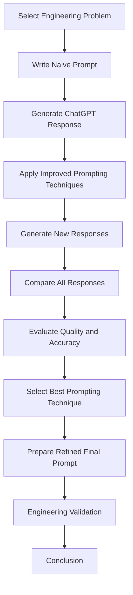

# EXPERIMENT 5: Comparing Prompting Techniques Through Engineering Problem-Solving Scenarios

## 1. AIM

To compare different prompting techniques and evaluate their effectiveness in solving real-world engineering problems using ChatGPT. The experiment aims to analyse how prompt structure, clarity, context and constraints influence the quality, accuracy, completeness and usefulness of AI-generated responses.

## 2. PROJECT TITLE

**Smart Crop Disease Detection Using Deep Learning**

## 3. PROBLEM STATEMENT

Agriculture plays an important role in the economy, but crop production is frequently affected by various plant diseases. These diseases can reduce crop quality and productivity, resulting in financial losses for farmers.

Traditional disease identification methods mainly depend on manual observation and expert knowledge. These methods can be time-consuming and may lead to incorrect identification, especially when symptoms of different diseases appear similar.

To overcome these problems, a Smart Crop Disease Detection System is proposed using Artificial Intelligence, Image Processing and Deep Learning.

The system analyses images of plant leaves and identifies possible diseases using a Convolutional Neural Network (CNN). It processes the uploaded leaf image, extracts relevant features and classifies the image into an appropriate disease category.

The objective is to develop an automated, affordable and user-friendly system that helps identify crop diseases at an early stage.

## 4. SELECTED ENGINEERING SCENARIO

**Scenario:** Developing an AI-based crop disease detection system using computer vision and deep learning.

### Objectives

- To collect images of healthy and diseased plant leaves.
- To preprocess images for efficient model training.
- To develop a CNN-based disease classification model.
- To identify crop diseases from uploaded images.
- To evaluate model performance using standard classification metrics.
- To develop a simple interface for displaying prediction results.

### Technologies Required

| Component | Technology |
|---|---|
| Programming Language | Python |
| Deep Learning | TensorFlow / Keras |
| Image Processing | OpenCV |
| Model Architecture | CNN |
| Dataset | PlantVillage Dataset |
| Data Analysis | NumPy, Pandas |
| Visualization | Matplotlib |
| Development Environment | Google Colab / Jupyter Notebook |

## 5. SYSTEM ARCHITECTURE

The proposed system consists of five major stages:

1. **Image Acquisition:** Collect or upload images of plant leaves.
2. **Image Preprocessing:** Resize images, normalize pixel values and perform data augmentation.
3. **Feature Extraction:** Use CNN layers to extract important image features.
4. **Disease Classification:** Classify the input image into healthy or disease categories.
5. **Result Display:** Display the predicted disease category to the user.

### System Architecture Diagram

## 6. BASE PROMPT (NAÏVE PROMPT)

A naïve prompt is a simple instruction given to ChatGPT without providing detailed background information, technical requirements or specific constraints.

**Prompt:**

"How can I detect crop diseases using AI?"

### Expected ChatGPT Response

ChatGPT may suggest using Artificial Intelligence, image processing and machine learning to identify crop diseases. It may recommend using image classification techniques such as CNN.

### Observation

The response provides a basic understanding of the problem but does not necessarily include implementation details, datasets, model architecture or evaluation methods.

## 7. IMPROVED PROMPTS USING DIFFERENT PROMPTING TECHNIQUES

### Technique 1 – Straightforward Prompting

This technique provides a direct and clear instruction describing the task.

**Prompt:**

"Suggest a suitable method to detect crop diseases using computer vision and deep learning. Explain the basic working process and recommend an appropriate algorithm."

**Expected ChatGPT Response:**

ChatGPT may recommend a Convolutional Neural Network (CNN) for image classification. It may explain that CNN extracts visual features from leaf images and uses them to identify disease categories.

**Advantages:**
- Simple and understandable.
- Directly addresses the problem.
- Provides a suitable starting point.

### Technique 2 – Role-Based Prompting

This technique assigns a specific professional role to ChatGPT to obtain a response from a particular perspective.

**Prompt:**

"Act as an experienced Machine Learning Engineer. Explain how to develop a crop disease detection system using CNN and image processing. Recommend suitable algorithms, tools and implementation methods."

**Expected ChatGPT Response:**

ChatGPT may provide an engineering-oriented explanation covering CNN architecture, convolution layers, pooling layers, activation functions, model training and image preprocessing.

It may also recommend Python, TensorFlow, Keras and OpenCV.

**Advantages:**
- Provides domain-oriented explanations.
- Improves technical relevance.
- Helps understand engineering implementation.

### Technique 3 – Context-Based Prompting

This technique provides background information about the project and its requirements.

**Prompt:**

"I am developing a final-year engineering project titled Smart Crop Disease Detection Using Deep Learning. The system should identify plant diseases from uploaded leaf images. Suggest a suitable architecture, datasets, algorithms and implementation steps."

**Expected ChatGPT Response:**

ChatGPT may suggest a complete project architecture involving image uploading, preprocessing, CNN-based classification and result display.

It may also recommend using the PlantVillage dataset for initial model development.

**Advantages:**
- Provides project-specific responses.
- Reduces irrelevant suggestions.
- Helps align the solution with project objectives.

### Technique 4 – Step-by-Step Prompting

This technique instructs ChatGPT to explain the solution through an ordered sequence of steps.

**Prompt:**

"Explain step by step how to develop a crop disease detection system using deep learning. Include dataset collection, image preprocessing, model development, training, testing, evaluation and deployment."

**Expected ChatGPT Response:**

ChatGPT may generate the following implementation sequence:

1. Collect healthy and diseased leaf images.
2. Organize images into appropriate classes.
3. Resize and normalize images.
4. Divide the dataset into training, validation and testing sets.
5. Develop a CNN architecture.
6. Train the model using the training dataset.
7. Evaluate the model using unseen images.
8. Deploy the trained model through a simple user interface.

**Advantages:**
- Provides an organized implementation plan.
- Makes complex tasks easier to understand.
- Helps identify the development stages.

### Technique 5 – Constraint-Based Prompting

This technique specifies limitations and requirements that the generated solution must satisfy.

**Prompt:**

"Design a crop disease detection system using Python and CNN. The implementation should be affordable and suitable for an engineering student with limited computational resources. Include dataset requirements, model selection, preprocessing techniques, evaluation metrics and possible limitations."

**Expected ChatGPT Response:**

ChatGPT may recommend using a lightweight CNN architecture, transfer learning with MobileNetV2, Google Colab for model training and TensorFlow for implementation.

It may also suggest using accuracy, precision, recall and F1-score to evaluate classification performance.

**Advantages:**
- Provides practical recommendations.
- Considers available resources.
- Helps reduce implementation complexity.
- Produces solutions that are easier to implement.

## 8. AI-GENERATED OUTPUTS

The following table summarizes the expected responses obtained using different prompting techniques.

| Prompt Technique | Generated Output |
|---|---|
| Naïve Prompt | General suggestions about AI-based crop disease detection. |
| Straightforward Prompt | Recommended CNN and image classification. |
| Role-Based Prompt | Technical explanation of CNN architecture and image processing. |
| Context-Based Prompt | Project-specific architecture and implementation suggestions. |
| Step-by-Step Prompt | Ordered development procedure from dataset collection to deployment. |
| Constraint-Based Prompt | Affordable implementation approach with suitable tools and evaluation metrics. |

**Note:** These are summarized expected outputs. Actual ChatGPT responses should be captured separately during the experiment.

## 9. COMPARISON AND EVALUATION TABLE

The responses are compared using the following evaluation criteria.

| Evaluation Criteria | Naïve Prompt | Improved Prompts |
|---|---|---|
| Quality | Average | Better structured |
| Accuracy | General suggestions | More task-specific |
| Depth | Limited | More detailed |
| Clarity | Basic | Clear instructions and explanations |
| Completeness | Limited information | Covers more requirements |
| Feasibility | General approach | More practical suggestions |
| Usefulness | Suitable for initial ideas | Useful for implementation planning |

### Prompting Technique Comparison

| Technique | Main Benefit | Suitable Application |
|---|---|---|
| Straightforward | Direct answers | Basic technical questions |
| Role-Based | Expert-oriented responses | Technical guidance |
| Context-Based | Project relevance | Project-specific solutions |
| Step-by-Step | Structured explanations | Implementation planning |
| Constraint-Based | Practical recommendations | Resource-limited projects |

## 10. ANALYSIS AND OBSERVATIONS

After comparing the different prompting techniques, the following observations can be made:

1. The naïve prompt generated a general response with limited technical information.
2. The straightforward prompt provided a basic approach for solving the engineering problem.
3. The role-based prompt encouraged technical explanations from a machine learning engineering perspective.
4. The context-based prompt generated responses more closely related to the actual project requirements.
5. The step-by-step prompt organized the implementation process into manageable stages.
6. The constraint-based prompt considered project limitations and suggested practical development methods.

### Key Findings

- Providing sufficient context improves the relevance of generated responses.
- Assigning a role can encourage domain-specific explanations.
- Step-by-step instructions improve the organization of complex answers.
- Adding constraints helps obtain more feasible engineering recommendations.
- Simple prompts remain useful when only basic information is required.

## 11. FINAL SELECTED PROMPTING TECHNIQUE

**Selected Technique: Constraint-Based Prompting**

Constraint-based prompting is selected as the most suitable technique for this engineering scenario because it considers the practical requirements and limitations of the project.

It helps obtain recommendations based on programming languages, available datasets, computational resources, model selection and evaluation methods.

This makes the generated response more useful for planning an actual engineering implementation.

## 12. REFINED / FINAL PROMPT

"Act as an expert Machine Learning Engineer. I am developing a final-year engineering project titled Smart Crop Disease Detection Using Deep Learning.

Design a complete crop disease detection system that identifies plant diseases from leaf images using Python and CNN.

Explain the following requirements in detail:

1. Dataset collection and preparation.
2. Image preprocessing and augmentation.
3. Suitable CNN architecture and model selection.
4. Model training and validation.
5. Disease classification and prediction.
6. Evaluation using accuracy, precision, recall and F1-score.
7. Model testing using unseen leaf images.
8. Deployment using a simple user interface.

Recommend suitable datasets, Python libraries and development tools. Consider limited computational resources and suggest an affordable implementation suitable for an engineering student.

Also explain possible limitations, challenges and future improvements."

## 13. ENGINEERING VALIDATION

The AI-generated suggestions must be verified through actual implementation and testing.

### Validation Methods

**1. Dataset Validation**

- Verify that the dataset contains correctly labelled healthy and diseased images.
- Check for duplicate and corrupted images.
- Ensure that different classes have sufficient samples.

**2. Model Validation**

- Train the CNN model using the training dataset.
- Use validation data to monitor model performance.
- Test the model using previously unseen images.

**3. Performance Evaluation**

The following metrics can be used:

- Accuracy
- Precision
- Recall
- F1-score
- Confusion matrix

**4. Practical Testing**

- Upload different plant leaf images.
- Verify whether the predicted class matches the actual label.
- Test images under different lighting and background conditions.
- Identify cases where the model produces incorrect predictions.

### Evaluation Formulas

Accuracy:

Accuracy = (TP + TN) / (TP + TN + FP + FN)

Precision:

Precision = TP / (TP + FP)

Recall:

Recall = TP / (TP + FN)

F1-Score:

F1-Score = 2 × (Precision × Recall) / (Precision + Recall)

Where:

- TP = True Positive
- TN = True Negative
- FP = False Positive
- FN = False Negative

Actual model performance should be measured experimentally. ChatGPT-generated recommendations alone do not establish model accuracy.

## 14. PROMPTING WORKFLOW

The following flowchart represents the experiment procedure.

## 15. RESULT ANALYSIS

The experiment demonstrates that the structure of a prompt influences the type and depth of information generated by ChatGPT.

A simple prompt is useful for obtaining introductory information. However, improved prompting techniques provide additional context, technical direction and implementation requirements.

Among the techniques tested, constraint-based prompting provides a practical approach for obtaining engineering-oriented recommendations.

The final response should still be verified through technical documentation, dataset testing and actual model implementation.

## 16. CONCLUSION

The experiment successfully compares different prompting techniques for solving a real-world engineering problem.

The results indicate that prompt clarity, context, role assignment and constraints can improve the relevance, structure and usefulness of AI-generated responses.

The naïve prompt is suitable for obtaining basic information, while improved prompts are more appropriate for technical explanations and implementation planning.

Among the techniques evaluated, constraint-based prompting was selected as the preferred approach because it considers practical requirements and available resources.

Thus, effective prompt engineering plays an important role in obtaining useful AI-generated solutions for engineering applications.

## 17. RESULT

The different prompting techniques were successfully formulated and compared using ChatGPT for the selected engineering problem. The experiment demonstrated that structured and well-defined prompts can produce more relevant, detailed and useful responses than simple naïve prompts.
